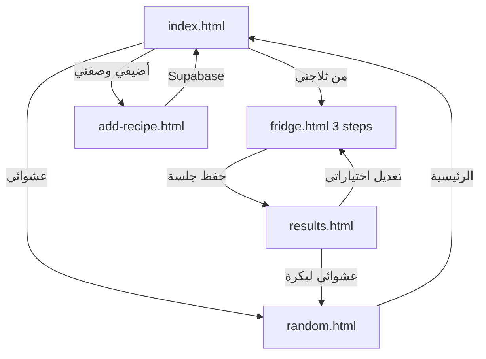

# ثلاجتي (Thalajati) — Software Requirements Specification

مساعد قرار لطبخ البيت: يقترح وصفات من محتويات الثلاجة، أو اقتراحًا عشوائيًا لطبق رئيسي بدون تكرار ممل خلال أسبوع، مع إمكانية إضافة وصفات شخصية تغذي نفس محرك القرار.

| | |
|---|---|
| **النوع** | تطبيق ويب ثابت (HTML / CSS / JS) + جدول Supabase للوصفات المضافة |
| **اللغة** | عربية، اتجاه RTL |
| **المستودع** | https://github.com/Alkabkabi1/thalajati |
| **الجمهور** | من يدير طبخ البيت يوميًا ويريد قرارًا سريعًا + قائمة شراء |

---

## 1. الغرض والنطاق

### 1.1 الغرض
تقليل تردد «وش نطبخ؟» عبر:
1. **من الثلاجة** — مطابقة مكونات متوفرة + ممنوعات + عدد أشخاص → قائمة وصفات مصنّفة.
2. **عشوائي لبكرة** — طبق رئيسي واحد مع زر «غيرها»، مع تجنّب التكرار خلال 7 أيام.
3. **أضيفي وصفتي** — وصفة شخصية تُحفظ في Supabase وتدخل نفس المطابقة والعشوائي.

### 1.2 داخل النطاق
- واجهة عربية كاملة بدون حساب مستخدم.
- كتالوج وصفات محلي (خليجي / إيطالي / مكسيكي) مع صور أطباق حقيقية.
- وصفات مستخدم مشتركة عبر جدول `user_recipes` في Supabase (بدون تسجيل دخول).
- جلسة نتائج وممنوعات في التخزين المحلي للمتصفح.
- فلاتر أقسام ومطابخ على شاشة النتائج.
- قائمة شراء مجمّعة للناقص.

### 1.3 خارج النطاق
- حسابات، مدفوعات، تعديل/حذف وصفات المستخدم من الواجهة.
- رفع صور للوصفات المضافة.
- تطبيق أصلي (iOS/Android) أو PWA إلزامي.
- توصية مدعومة بتعلّم آلة.

---

## 2. المستخدمون والسيناريوهات

| المستخدم | الهدف | المسار |
|----------|--------|--------|
| ربّ/ربّة منزل يقرر بسرعة | أكل من اللي موجود | `index` → `fridge` (٣ خطوات) → `results` |
| متردد لبكرة | اقتراح واحد بدون تفكير | `index` → `random` |
| يحتاج تسوق | يعرف الناقص | قائمة الشراء في `results` + تلميح داخل البطاقة |
| يبغى وصفاته تدخل القرار | يضيف وصفة بمكونات معروفة | `index` → `add-recipe` → تُستخدم في الثلاجة/العشوائي |

---

## 3. المتطلبات الوظيفية

### 3.1 الصفحة الرئيسية (`index.html`)
- **FR-01** عرض هوية المنتج (رمز ثلاجة + اسم + وعد قصير).
- **FR-02** مساران واضحان: «وش أسوي من ثلاجتي؟» و«بكرة نطبخ إيش؟».
- **FR-03** بطاقة «مثال نتيجة» بنفس شكل بطاقة الوصفة (صورة علوية + عنوان).
- **FR-04** رابط ثانوي «أضيفي وصفتي» إلى نموذج الإضافة.

### 3.2 مسار الثلاجة (`fridge.html`)
- **FR-10** ثلاث خطوات مع شريط تقدّم: أشخاص → ممنوعات → مكونات.
- **FR-11** عدّ بالغين/أطفال (حد أدنى شخص واحد للمتابعة).
- **FR-12** ممنوعات اختيارية مع زر تخطّي؛ الحفظ على الجهاز فقط مع جملة شفافية.
- **FR-13** اختيارات مكونات سريعة (٨ عناصر شائعة) ظاهرة دائمًا.
- **FR-14** بقية المكونات مجمّعة (بروتينات / نشويات / خضار / ألبان / أخرى) ومطوية افتراضيًا.
- **FR-15** خيار «ما عندي شي بالثلاجة» يقترح وصفات بسيطة مع قائمة شراء كاملة.
- **FR-16** بعد اختيار ≥ ٣ مكونات: زر ثانوي «ورّيني النتائج بهاللي اخترت» ينهي المسار فورًا.
- **FR-17** عند الإنهاء: حساب التطابق وحفظ الجلسة والانتقال إلى `results.html`.

### 3.3 النتائج (`results.html`)
- **FR-20** عرض وصفات الجلسة مقسّمة حسب القسم (تبويبات).
- **FR-21** وصفة واحدة في كل مرة مع أسهم ‹ › ومصغّرات خفيفة للمقارنة.
- **FR-22** فلاتر أقسام/مطابخ مطوية افتراضيًا، مع ملخص وحالة عند التضييق.
- **FR-23** داخل البطاقة: مكونات (عندك / اشتري)، خطوات، تلميح تسوق.
- **FR-24** قائمة شراء مجمّعة أسفل الصفحة لكل الناقص غير الاختياري.
- **FR-25** حالة فراغ مع مخارج (تعديل المكونات / عشوائي / اقتراحات شائعة).
- **FR-26** رابط الرجوع لتعديل اختيارات الثلاجة.

### 3.4 العشوائي (`random.html`)
- **FR-30** اقتراح طبق من فئة `main` فقط.
- **FR-31** استبعاد الممنوعات المحفوظة وتجنّب وصفات شوهدت خلال 7 أيام قدر الإمكان.
- **FR-32** زر «غيرها» يعيد الاقتراح مع تلاشي بصري قصير.
- **FR-33** تلميح ثابت: «مو مناسب؟ اضغطي غيرها».

### 3.5 إضافة وصفة (`add-recipe.html`)
- **FR-50** نموذج بسيط: اسم، قسم، مطبخ، وقت، مكونات من `COMMON_INGREDIENTS`، خطوات اختيارية.
- **FR-51** الحفظ في جدول Supabase `user_recipes` (بدون حساب).
- **FR-52** الوصفات المحفوظة تدخل `getAllRecipes()` فتُستخدم في المطابقة والعشوائي.
- **FR-53** رابط ثانوي من الرئيسية دون منافسة زري القرار.

### 3.6 المحتوى والصور
- **FR-40** كل وصفة لها: اسم، صورة `images/dish-*.jpg`، مطبخ، قسم، مدة، حصص، وسوم، مكونات، خطوات.
- **FR-41** المطابخ: خليجي، إيطالي، مكسيكي.
- **FR-42** الأقسام: رئيسي، حلويات، عصائر، شوربات، خبز، معجنات، جانبي.

---

## 4. المتطلبات غير الوظيفية

| المعرّف | المتطلب |
|---------|---------|
| **NFR-01** | يعمل بفتح الملفات محليًا أو عبر أي استضافة ثابتة (لا بناء إلزامي). |
| **NFR-02** | واجهة RTL مع `lang="ar"`. |
| **NFR-03** | تصميم موبايل أولًا؛ عرض محتوى محدود (~40rem). |
| **NFR-04** | لا تُرسل الممنوعات أو الجلسة إلى خادم — `localStorage` فقط. |
| **NFR-05** | صور الأطباق بإطار موحّد (نسبة 4:3، `object-fit: cover`) قدر الإمكان دون إعادة ضغط مدمّر. |
| **NFR-06** | خطوط عربية عبر Google Fonts (Cairo + IBM Plex Sans Arabic). |
| **NFR-07** | تلاشي قصير (~300ms) عند تبديل الوصفة في النتائج والعشوائي. |

---

## 5. تدفقات المستخدم



### مسار الثلاجة (تفصيل)
1. عدد الأشخاص  
2. ممنوعات (أو تخطّي) — تُحفظ على الجهاز  
3. مكونات سريعة و/أو كل المكونات و/أو ثلاجة فاضية  
4. إنهاء → مطابقة → `results`

---

## 6. المعمارية وبنية الملفات

```
thalajati/
├── index.html          # الرئيسية
├── fridge.html         # استبيان الثلاجة
├── results.html        # النتائج + فلاتر
├── random.html         # اقتراح عشوائي
├── add-recipe.html     # إضافة وصفة مستخدم
├── css/styles.css      # التصميم الكامل
├── js/
│   ├── recipes.js      # الكتالوج، المجموعات، المطابقة
│   ├── user-recipes.js # جلب/حفظ وصفات Supabase
│   ├── supabase-config.js  # URL + anon key
│   ├── storage.js      # جلسة/ممنوعات محلية
│   ├── fridge.js       # منطق الاستبيان
│   ├── results.js      # فلاتر + قائمة شراء
│   ├── random.js       # الاقتراح العشوائي
│   ├── add-recipe.js   # نموذج الإضافة
│   └── ui.js           # بطاقات، عارض القائمة، تأثيرات
├── supabase/
│   └── user_recipes.sql
├── docs/
│   └── hackathon-tasks.md
├── images/dish-*.jpg   # صور الأطباق
└── scripts/            # تنزيل/إعادة بناء صور من ويكيميديا (اختياري)
```

### إعداد Supabase (مرة واحدة)
1. أنشئ مشروعًا مجانيًا في Supabase.
2. نفّذ [`supabase/user_recipes.sql`](supabase/user_recipes.sql) من SQL Editor.
3. انسخ Project URL و anon public key إلى [`js/supabase-config.js`](js/supabase-config.js).
4. لا تستخدم ولا ترفع service role key.

**نموذج البيانات (وصفة):**  
`id`, `name`, `image`, `cuisine`, `category`, `minutes`, `servingsAdult`, `tags[]`, `ingredients[{key,label,optional?}]`, `steps[]`

**جلسة النتائج (`thalajati.session`):**  
`adults`, `kids`, `blocked`, `available`, `emptyFridge`, `categories`, `cuisines`, `matches[]`

**مفاتيح التخزين:**
| مفتاح | الاستخدام |
|-------|-----------|
| `thalajati.blocked` | الممنوعات الدائمة على الجهاز |
| `thalajati.session` | نتيجة آخر استبيان |
| `thalajati.recentRandom` | معرفات العشوائي خلال 7 أيام |

---

## 7. قواعد المطابقة (ملخص)

- تُستبعد الوصفات التي تحتوي مكوّنًا في قائمة الممنوعات.
- تُفضَّل الوصفات ذات تقاطع أعلى مع المكونات المتوفرة.
- تُراعى الأقسام/المطابخ عند التصفية في النتائج (وفي الحساب الابتدائي حسب الجلسة).
- الثلاجة الفارغة: اقتراحات بسيطة مع اعتبار أغلب المكونات للشراء.
- العشوائي: `category === "main"` فقط.

---

## 8. واجهات الشاشات (ملخص UX الحالي)

| الشاشة | عناصر أساسية |
|--------|----------------|
| الرئيسية | علامة + مثال نتيجة + زران قرار + رابط «أضيفي وصفتي» |
| الثلاجة | تقدّم ٣ خطوات، chips، مجموعات مطوية، CTA مبكر |
| النتائج | عنوان، فلاتر مطوية، تبويبات أقسام، بطاقة + أسهم + مصغّرات، شراء، شريط سفلي |
| عشوائي | بطاقة طبق رئيسي + غيرها + تلميح |
| إضافة وصفة | اسم، قسم، مطبخ، chips مكونات، خطوات اختيارية |

---

## 9. التشغيل محليًا

1. انسخ المستودع أو افتح المجلد.
2. افتح `index.html` في المتصفح (أو استخدم خادمًا ثابتًا بسيطًا إن رغبت).
3. لا حاجة لـ `npm install`.

### سكربتات الصور (اختياري)
- `scripts/download-images.ps1` / `scripts/rebuild-wiki-images.ps1` — لإعادة جلب صور الأطباق من مصادر ويكيميديا عند الحاجة.

---

## 10. القيود والمخاطر المعروفة

- المحتوى ثابت في `recipes.js`؛ أي وصفة جديدة تتطلب تعديل الكود.
- لا مزامنة بين الأجهزة.
- قصّ الصور بـ `cover` قد يقطع أطراف بعض الصور الأفقية.
- سطح المكتب يظهر بمحتوى ضيق عمدًا (موبايل أولًا).

---

## 11. معايير القبول (عامة)

- [ ] المساران من الرئيسية يعملان بدون أخطاء في المتصفح.
- [ ] مسار الثلاجة يكتمل في ٣ خطوات ويصل لنتائج غير فارغة مع مكونات شائعة.
- [ ] الممنوعات تُحفظ وتُستبعد في النتائج والعشوائي.
- [ ] الفلاتر تضيّق القائمة دون إعادة الاستبيان.
- [ ] العشوائي لا يقترح غير الأطباق الرئيسية.
- [ ] الواجهة عربية RTL على الموبايل بشكل مقروء.

---

— *ثلاجتي — مواصفات المتطلبات / وثيقة المنتج*
